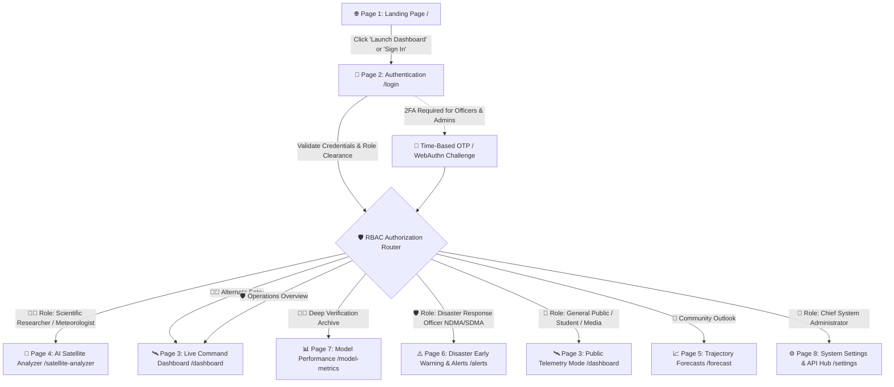

# 🔐 CYCLO-AI: Page 2 — Authentication & Role-Based Access Specification (`/login`, `/register`)

**Project Topic:**  
> *"To develop an Artificial Intelligence (AI) / Machine Learning (ML) based system for identification, classification, and prediction of different tropical cyclone patterns using multi-source satellite data."*

**Document Scope:** Complete Architectural, Technical, Operational, Cryptographic, Role-Based Access Control (RBAC), UI/UX Component, and Engineering Specification of **Page 2: Authentication & Role-Based Access (`/login`, `/register`)**.

---

## 🗺️ 1. Navigation Flow & System Context

Page 2 serves as the primary security gateway and role-validation checkpoint for the CYCLO-AI platform. It controls access to high-compute deep learning inference engines, sensitive multi-spectral space agency feeds (ISRO MOSDAC, NOAA, EUMETSAT), and emergency alert cell-broadcast tools (NDMA, SDMA, IMD).



---

## 📐 2. Visual Layout & Wireframe Architecture

The authentication interface adopts an elite **Split-Screen Aerospace Mission-Control Layout**:
- **Left Panel (50% on Desktop):** Dynamic 3D Atmospheric Vortex Canvas with active satellite orbital passes, real-time tropical cyclone telemetry ticker, and live platform security status.
- **Right Panel (50% on Desktop):** Multi-layered Glassmorphic Auth Terminal featuring role-selector rails, precision form controls with cyber validation, institutional SSO federation, and 2FA challenge overlays.

```
┌──────────────────────────────────────────────────────────────────────────────────────────────────────────────────┐
│ [CYCLO-AI COMMAND GATEWAY]                                                       [Status: 🟢 IMD-GTS SECURE]     │
├──────────────────────────────────────────────────┬───────────────────────────────────────────────────────────────┤
│ 🛰️ ATMOSPHERIC VORTEX & SATELLITE RADAR CANVAS    │ 🔐 MISSION-CONTROL AUTHENTICATION TERMINAL                    │
│                                                  │                                                               │
│ [LIVE ORBITAL PASS: INSAT-3DR (08:30 UTC)]       │ [ 🔀 SIGN IN ]                 [ ➕ CREATE ACCOUNT ]          │
│                                                  │ ───────────────────────────────────────────────────────────── │
│                🌀                                │ SELECT OPERATIONAL ROLE:                                      │
│      . - ~ ~ ~ - .      [VORTEX: ACTIVE]         │ ┌────────────────┐ ┌────────────────┐ ┌─────────────────────┐ │
│    /   ●   ○       \    Storm: CYCLONE MOCHA     │ │ 🧑‍🔬 RESEARCHER │ │ 🛡️ DISASTER EOC│ │ 👤 GENERAL PUBLIC   │ │
│   |   ○     ●   ○   |   Basin: Bay of Bengal     │ │ IMD / Scientific│ │ NDMA / SDMA    │ │ Read-Only Forecasts │ │
│    \       ○       /    Pressure: 938 hPa        │ └────────────────┘ └────────────────┘ └─────────────────────┘ │
│      ' - . _ . - '      Max Winds: 195 km/h      │                                                               │
│                         Category: VSCS (Cat 4)   │ INSTITUTIONAL EMAIL / USER IDENTIFIER:                        │
│                                                  │ ┌───────────────────────────────────────────────────────────┐ │
│ ──────────────────────────────────────────────── │ │ dr.mukherjee@imd.gov.in                                 │ │
│ 📡 TELEMETRY STATUS HUD                          │ └───────────────────────────────────────────────────────────┘ │
│ • Multi-Source Ingestion: INSAT, NOAA, OSCAT     │                                                               │
│ • Deep Learning Checkpoint: v2.4-convnext-vit    │ OPERATIONAL PASSWORD:                                         │
│ • CAP Alert Dispatch Mesh: READY                 │ ┌─────────────────────────────────────────────────────────┬─┐ │
│ • Cryptographic Hash: AES-256-GCM / SHA-512      │ │ ••••••••••••••••••••••••••••••••••••••••••••••••••••••• │👁│ │
│                                                  │ └─────────────────────────────────────────────────────────┴─┘ │
│ "Authorized personnel access only. Actions are   │ Security Entropy: [████████████████████] 100% (Cryptographic) │
│  logged under Indian Official Secrets Act."      │                                                               │
│                                                  │ [✓] MANDATORY AGENCY BADGE VERIFICATION (Officers only):      │
│                                                  │ ┌───────────────────────────────────────────────────────────┐ │
│                                                  │ │ Badge / Officer PIN: [ NDMA-OD-2026-98124              ] │ │
│                                                  │ └───────────────────────────────────────────────────────────┘ │
│                                                  │                                                               │
│                                                  │ [✓] Remember this secure terminal   [ Forgot Credentials? ↗ ] │
│                                                  │                                                               │
│                                                  │ ┌───────────────────────────────────────────────────────────┐ │
│                                                  │ │ 🚀 AUTHENTICATE & ENTER COMMAND TERMINAL                  │ │
│                                                  │ └───────────────────────────────────────────────────────────┘ │
│                                                  │                                                               │
│                                                  │ ────────────── INSTITUTIONAL SSO FEDERATION ──────────────── │
│                                                  │ [ 🏛️ MeriPehchan / Parichay ]  [ 🛰️ ISRO MOSDAC Direct ID ]  │
└──────────────────────────────────────────────────┴───────────────────────────────────────────────────────────────┘
```

---

## 🧩 3. Section-by-Section Feature Specifications

### Section A: Environmental Atmosphere & Live Satellite Canvas (Left Horizon)
* **Component ID:** `#auth-satellite-canvas`
* **Visual Atmosphere:**
  * Background deep canvas set to `#050B14` (Deep Oceanic Abyss) with subtle stationary noise grain (`patternAlpha={18}`).
  * Interactive 2D/3D WebGL cyclone vortex simulation with animated cloud streamlines and eye-wall rotational dynamics using GLSL shaders.
  * Orbital scanning beam representing real-time satellite footprint sweeps (INSAT-3D/3DR, NOAA-20, MetOp-C).
* **Live Storm & Mission Telemetry Card:**
  * Active tropical depression/cyclone tracker showing current operational threat (e.g., *Cyclone Mocha / Cat 4*).
  * Real-time meteorological readings: Central Pressure ($hPa$), Maximum Sustained Winds ($km/h$), Dvorak CI index ($CI\ 6.0$).
  * Institutional integrity notice: Displaying National Disaster Management standards, encryption seals, and audit logging compliance flags.

---

### Section B: Dual Terminal Mode Switcher (`Sign In` vs `Register`)
* **Component ID:** `#auth-terminal-mode-pills`
* **Design & Physics:**
  * Styled with the unified pill rail architecture (`bg-[#0F1B2F]/90 backdrop-blur-xl border border-[rgba(0,242,254,0.4)] rounded-xl p-1 shadow-[0_4px_16px_rgba(0,0,0,0.6),0_0_12px_rgba(0,242,254,0.15)]`).
  * Smooth tab switching between:
    1. **Sign In Mode (`/login`):** Direct credential validation and 2FA gateway for existing personnel.
    2. **Register Mode (`/register`):** Account provisioning with agency verification vetting and institutional clearance workflows.
* **Physics Animation:** GSAP animated pill slider indicator seamlessly sliding between tabs with spring easing.

---

### Section C: Role-Based Access Control (RBAC) Classifier Rail
* **Component ID:** `#auth-role-selector`
* **Role Taxonomy:**
  1. 🧑‍🔬 **Meteorologist & Scientific Researcher:**
     * **Target Audience:** IMD scientists, ISRO SAC researchers, NCMRWF climate modelers, university climatologists.
     * **Clearance Privileges:** Full access to raw multi-spectral satellite channels (TIR-1, TIR-2, WV, VIS, OSCAT), deep learning inference parameters (PINN Navier-Stokes loss penalty tuning, Dvorak classification), Grad-CAM explainability heatmaps, and NetCDF-4 export.
  2. 🛡️ **Disaster Response Official (NDMA / SDMA / EOC):**
     * **Target Audience:** National Disaster Management Authority, State Disaster Operations (Odisha, WB, AP, TN, Gujarat), District Collectors, Armed Forces Disaster Relief.
     * **Clearance Privileges:** Coastal digital twin inundation views, district vulnerability impact matrix, multi-lingual automated bulletin generation, Common Alerting Protocol (CAP) emergency cell broadcast triggers.
  3. 👤 **General Public / Student / Journalist:**
     * **Target Audience:** Coastal residents, maritime fishers, school/university students, news agencies.
     * **Clearance Privileges:** High-level interactive track viewer, cone of uncertainty, public safety warning bulletins, shelter locations, emergency helpline dials (Read-only, rate-limited).
  4. 🔑 **System Administrator (EOC Root Access):**
     * **Target Audience:** Designated Mission-Control Site Administrators.
     * **Clearance Privileges:** Hardware telemetry monitoring (GPU VRAM, latency), satellite API key rotation, developer REST token generation, full security audit trail inspection.

#### 📊 RBAC Permissions Matrix Table

| Clearance Level | Operational Role | Satellite Analyzer | AI Inference Tuning | Disaster Alerts (CAP) | System Settings & APIs | Security Audit Logs |
| :--- | :--- | :---: | :---: | :---: | :---: | :---: |
| **Tier 1 (Root)** | 🔑 System Admin | ✅ Read/Write | ✅ Full Access | ✅ Authorize Test | ✅ Full Control | ✅ Export / Inspect |
| **Tier 2 (Science)** | 🧑‍🔬 Meteorologist | ✅ Read/Write | ✅ Tune Weights | 👁️ Read Preview | 👁️ View Telemetry | 👁️ View Own Logs |
| **Tier 3 (Tactical)**| 🛡️ Disaster Official| 👁️ Read Map | ❌ Restricted | ✅ Broadcast Live | 👁️ Webhook Status | 👁️ View Broadcasts|
| **Tier 4 (Public)** | 👤 General Public | ❌ Disabled | ❌ Disabled | 👁️ Read Advisory | ❌ Disabled | ❌ Disabled |

---

### Section D: Precision Form Controls & Cyber Input Validation
* **Component IDs:** `#input-auth-email`, `#input-auth-password`, `#input-auth-agency-badge`
* **Form Field Specifications:**
  1. **Institutional Identifier (Email / Username):**
     * Domain autocomplete intelligence for verified government and research domains (`@imd.gov.in`, `@isro.gov.in`, `@ndma.gov.in`, `@incois.gov.in`, `@noaa.gov`, `@wmo.int`).
     * Real-time RFC 5322 regex validation with instantaneous visual cues (Cyan highlight on valid, Solar Coral on syntax failure).
  2. **Operational Password Field:**
     * Password masking with responsive SVG eye toggle (Show / Hide with keyboard shortcut `Ctrl + /`).
     * **Real-time Entropy Meter:** 4-segment segmented cyber progress bar measuring:
       - Minimum 10 characters length.
       - Mixed alphanumeric casing.
       - Special symbols (`!@#$%^&*`).
       - Entropy evaluation preventing dictionary or common meteorological patterns (e.g., rejecting `cyclone2026`).
  3. **Government Agency Badge Verification (Required for Tier 2 & Tier 3):**
     * Agency selection dropdown (IMD, ISRO, NDMA, Odisha SDMA, West Bengal SDMA, Andhra Pradesh SDMA, Indian Navy, Coast Guard).
     * Officer Service Badge PIN / Identification Number input.
     * File upload for verified credential token / official digital certificate (`.pem`, `.p12`, or scanned badge image).
  4. **Device Trust & Recovery Options:**
     * *"Remember this operational terminal for 30 days"* checkbox with encrypted biometric device fingerprinting.
     * *"Forgot Credentials / Request Clearance Override"* modal flow routing through institutional EOC officer verification.

---

### Section E: Multi-Factor Authentication (MFA / 2FA) Modal Horizon
* **Component ID:** `#modal-auth-2fa`
* **Trigger Conditions:**
  * Mandatory for all Tier 1 (Admins), Tier 2 (Meteorologists), and Tier 3 (Disaster EOC Officials).
  * Automatically triggered on Tier 4 users if accessing from a new geographic ASN or unrecognized IP range.
* **MFA Verification Channels:**
  1. **TOTP Authenticator App:** 6-digit split input boxes with auto-focus advance, auto-clipboard paste detection, and 30-second rotating validity timer.
  2. **FIDO2 / WebAuthn Hardware Security Key:** USB/NFC hardware key challenge (YubiKey / Government PKI Smart Card).
  3. **Secure SMS / Email OTP Fallback:** Encrypted one-time passcode delivered to registered government mobile device.

---

### Section F: Institutional Single Sign-On (SSO) Federation
* **Component ID:** `#auth-sso-federation`
* **Connectors:**
  1. **🏛️ MeriPehchan / National Single Sign-On (NSSO):** Government of India national citizen and officer identity portal.
  2. **🛰️ ISRO / MOSDAC Direct Directory:** SAML 2.0 / OAuth2 authentication for SAC scientific personnel.
  3. **🌐 EduGAIN & ORCID ID:** Seamless authentication for academic researchers, international climatologists, and university research teams.

---

### Section G: Cyber Security, Cryptography & Threat Defense
* **Security Specifications:**
  * **Brute-Force & Credential Stuffing Defense:** Sliding-window rate limiter (5 failed attempts locks IP for 15 minutes; progressive exponential delays).
  * **Meteorological Captcha Verification:** Custom non-intrusive CAPTCHA challenge (identifying cyclone cloud pattern or Coriolis deflection direction) triggered on suspicious bot telemetry.
  * **Token Storage & Session Architecture:**
    - Short-lived Access Token: JWT (15-minute expiration) containing user UID and encrypted role claims.
    - Long-lived Refresh Token: Stored exclusively in `HttpOnly`, `Secure`, `SameSite=Strict` browser cookie with cryptographically enforced token rotation.
  * **Audit Logging Integration:** Every login attempt, failed verification, role elevation, and password update is immediately dispatched to **Page 8 (`SecurityAuditPanel.tsx`)** capturing Operator Name, Action, Category (`API` / `MODEL` / `AUTH`), Client IP, and Timestamp.

---

## 🎨 4. Design Tokens & Styling Architecture

To preserve the uncompromising command-center aesthetics, all elements in the authentication page strictly conform to [`COLOR_THEME.md`](file:///d:/SIH%202026/SIH2K26/COLOR_THEME.md) and [`TEXT_TYPES.md`](file:///d:/SIH%202026/SIH2K26/TEXT_TYPES.md):

### 🎨 Color Palette Mapping
* **Base Canvas (60%):** `#050B14` (Deep Oceanic Abyss) with linear gradient `linear-gradient(145deg, rgba(0, 242, 254, 0.08) 0%, rgba(15, 27, 47, 0.98) 40%, #070E1A 100%)`.
* **Structural Borders & Accents (30%):** `#00F2FE` (Electric Cyclone Cyan) with `border: 1.5px solid rgba(0, 242, 254, 0.45)` and ambient cyan glow `box-shadow: 0 0 16px rgba(0, 242, 254, 0.15)`.
* **Action Buttons:** Built with `<ScientistPillButton />` (`scientist-pill` cyan glow, rolling GSAP physics, and 3D bevel top highlight `inset 0 1px 0 rgba(224, 252, 255, 0.4)`).
* **Alerts & Warnings (10%):** `#FF5E36` (Solar Storm Coral) for invalid credentials and `#00E676` (Bioluminescent Green) for successful authentication seals.

### 🔤 Typography Specification
* **Terminal Brand & Titles:** `Orbitron 800` (Uppercase, `letter-spacing: 0.06em`).
* **Section & Role Labels:** `Rajdhani 700` (Uppercase, `letter-spacing: 0.05em`).
* **Telemetry, Badges & Entropy:** `JetBrains Mono 700` (`font-feature-settings: 'tnum' on`).
* **Input Fields & Descriptive Body:** `Plus Jakarta Sans 500` and `Inter 400`.

---

## 🏗️ 5. Implementation Architecture & Component Breakdown

```
src/
├── app/
│   ├── login/
│   │   └── page.tsx                      # Page 2 Server Container & SEO Metadata
│   └── register/
│       └── page.tsx                      # Registration & Agency Clearance Gateway
├── components/
│   └── auth/
│       ├── AuthLayout.tsx                # Split-screen responsive wrapper with noise overlay
│       ├── AuthVortexCanvas.tsx          # WebGL GLSL atmospheric storm simulation
│       ├── AuthTerminalCard.tsx          # Central glassmorphic form card with cyan border
│       ├── RoleSelectorRail.tsx          # Interactive 3-card role selector with badges
│       ├── AgencyVerificationModal.tsx   # Government Officer badge upload & verification
│       ├── TwoFactorChallengeModal.tsx   # TOTP 6-box input with countdown timer
│       ├── SsoFederationButtons.tsx      # Parichay, MOSDAC, and EduGAIN SSO triggers
│       └── PasswordEntropyBar.tsx        # Dynamic 4-tier cryptographic strength meter
└── lib/
    ├── auth/
    │   ├── authOptions.ts                # NextAuth / Custom JWT Session Provider
    │   ├── rbacRules.ts                  # Role permission guards and route interceptors
    │   └── cryptoUtils.ts                # AES-256 and SHA-512 credential hashing
```

---

## 🔒 6. Operational Validation & Safety Checkpoints

1. **Zero-Trust Network Access (ZTNA):** All API routes verify the JWT signature and role claims server-side prior to rendering protected operational panels.
2. **Disaster Continuity Protocol:** If external identity providers (MeriPehchan / MOSDAC LDAP) experience latency or downtime, the platform seamlessly switches to local cryptographic emergency cache with pre-authenticated offline token fallback.
3. **Audit Trail Persistence:** All authentication telemetry is permanently stored in the local SQLite/PostgreSQL audit database, accessible through **Page 8: System Settings & Security Audit Hub**.
