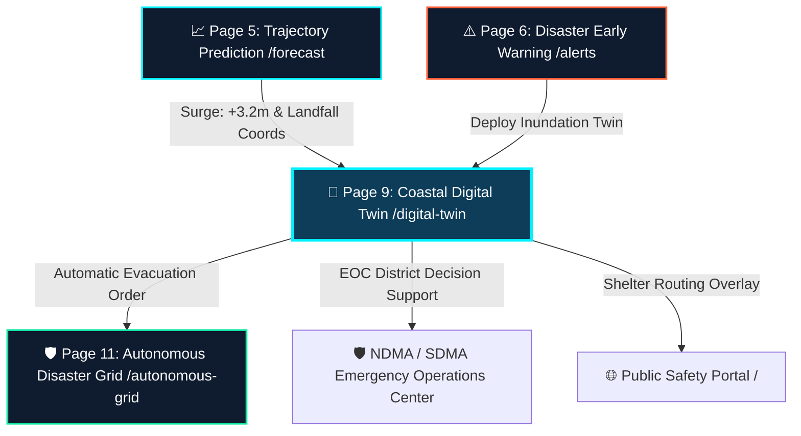

# 🌊 CYCLO-AI: Page 9 — Hyper-Local Coastal Inundation Digital Twin (`/digital-twin`)

**Project Topic:**
> *"To develop an Artificial Intelligence (AI) / Machine Learning (ML) based system for identification, classification, and prediction of different tropical cyclone patterns using multi-source satellite data."*

**Document Scope:** Complete Architectural, Technical, Geospatial, Hydrodynamic, and Functional Specification of **Page 9: Hyper-Local Coastal Inundation Digital Twin** — the system's real-world life-saving interface that translates AI forecast data into sub-street-level flood impact intelligence.

---

## 🗺️ 1. Navigation Flow & System Context

Page 9 is the **"Satellite-to-Street" Translator** of CYCLO-AI. It ingests pre-computed storm surge parameters from **Page 5 (`/forecast`)** and **Page 6 (`/alerts`)**, then visualizes exactly which roads, hospitals, power substations, and coastal villages will be submerged and to what depth — hours before the water arrives.



### Upstream Input Handoff Parameters (Query String)

When routed from Page 5 or Page 6, the URL carries hydro-modeling initialization data:

| Query Parameter | Example Value | Consumed By |
| :--- | :--- | :--- |
| `?surge=3.2m` | `3.2` (meters AAT) | Storm surge depth model seed |
| `?storm=arnab` | `arnab` | Active storm context selector |
| `?district=puri` | `puri` | Auto-focuses map and district matrix on Puri |
| `?lat=19.81&lng=85.83` | `19.81, 85.83` | Centers 3D viewport on projected landfall point |

---

## 📐 2. Viewport Layout & Visual Architecture

Page 9 adopts a **3D Tactical EOC (Emergency Operations Center) Layout** with a full-bleed immersive map canvas, an operational left panel, and a right-side district intelligence rail.

```
┌──────────────────────────────────────────────────────────────────────────────────────────────────────────────────┐
│ [CYCLO-AI DIGITAL TWIN] [Storm: ARNAB ▼] [District: Puri, Odisha ▼] [Surge: 3.2m ▼] [Auth: 🛡️ NDMA #4812]      │
├──────────────────┬───────────────────────────────────────────────────────────────┬───────────────────────────────┤
│ 🔧 TWIN CONTROLS │                                                               │ 📊 DISTRICT IMPACT RAIL       │
│ ─────────────── │    🌊 3D COASTAL INUNDATION MAP CANVAS (WebGL / MapLibre GL)  │ ─────────────────────────────│
│ Surge Level:     │                                                               │ 🏥 District Hospital          │
│ [━━━━━━━━━▸ 3.2m]│  [🏥 Hosp: 1.4m Flood] [⚡ 33kV: RISK] [🛣️ NH-316: CUT]    │   Flood Depth: 1.4m          │
│                  │                                                               │   Generator: CRITICAL         │
│ Surge Arrival:   │    ≈≈≈ 3.0m ZONE ≈≈≈≈≈≈≈≈≈≈≈≈≈≈≈≈≈≈≈ [RED]                 │   Evac Priority: 🔴 IMMED.   │
│ T+28h ETA        │         ≈≈≈ 1.5m ZONE ≈≈≈≈≈≈≈≈ [AMBER]                      │                               │
│                  │               ≈≈≈ 0.5m ZONE ≈≈ [CYAN]                        │ ⚡ Power Substation 33kV      │
│ Contour Layers:  │                                                               │   Node 04: FLOOD RISK         │
│ [✓] 0.5m (Cyan)  │     [🛡️ Shelter A: DRY] [🛡️ Shelter B: DRY]                │   Shutdown ETA: T+20h         │
│ [✓] 1.5m (Amber) │        [🛡️ Shelter C: FLOOD RISK 0.3m]                      │                               │
│ [✓] 3.0m (Red)   │                                                               │ 🛣️ NH-316 Status              │
│ [✓] 4.5m+ (Mag.) │  [📍 Landfall: Puri-Dhamra | T+28h | Wind: 165 km/h]        │   Km 44–67: SUBMERGED         │
│                  │                                                               │   Alt Route: SH-18 ✓ DRY     │
│ 3D View Mode:    │                                                               │                               │
│ [○] 2D Flat      │                                                               │ [ 🚨 ORDER EVACUATION ]       │
│ [●] 3D Oblique   │                                                               │ [ 🛡️ LAUNCH AUTO GRID ]       │
│ [ ] Satellite Tx │                                                               │ [ 📥 EXPORT GIS REPORT ]      │
│                  │                                                               │                               │
│ Playback:        │ 🛠️ [⛶ Full] [🔍+] [🔍-] [📏 Measure] [🎯 Landfall]          │ Timeline: T+0h ─── T+72h      │
│ [⏮️] [▶️] [⏹️]   │                                                               │ [━━━━━━▸] T+28h LANDFALL      │
└──────────────────┴───────────────────────────────────────────────────────────────┴───────────────────────────────┘
```

---

## 🧩 3. Section-by-Section Feature Specifications

### Section A: Top Operational Command Bar
* **Component ID:** `#twin-command-bar`
* **Features:**
  * **Storm Context Selector Dropdown:** Pulls from the active storm registry (same as `/dashboard`). Auto-loaded from `?storm=` query parameter.
  * **District Selector:** Populates coastal districts of the threatened state — Odisha: *Puri, Jagatsinghpur, Kendrapara, Bhadrak, Balasore*; West Bengal; Andhra Pradesh.
  * **Surge Threshold Selector:** Allows manual override of the surge seed (`1.0m`, `1.5m`, `2.0m`, `3.2m`, `4.5m`, `5.0m+`). Auto-loads from `?surge=` query parameter.
  * **RBAC Access Badge:** `🧑‍🔬 Scientist (High-Res 10m Mesh)` | `🛡️ Disaster EOC (District Matrix)` | `👤 Public (1km Zonal View)`.
  * **Live Warning Indicator:** Pulsing red `STAGE 3 WARNING` badge synchronized with Page 6 alert state.

---

### Section B: 3D Coastal Inundation Map Canvas (Main Viewport)
* **Component ID:** `#inundation-map-canvas`
* **Rendering Engine:** MapLibre GL JS (3D terrain extrusion) with WebGL surge overlay shaders.

#### B.1 — Terrain Extrusion & DEM Integration
* **Data Source:** SRTM 30m DEM (NASA/USGS Shuttle Radar Topography Mission) merged with GEBCO bathymetric grid.
* **3D Mesh:** Triangulated Irregular Network (TIN) with terrain extrusion — photorealistic 3D coastal topographic profile.
* **Elevation Reference:** Vertical datum aligned to Indian Mean Sea Level (MSL) — WGS84 / EGM2008 Geoid.
* **View Angles:**
  * `2D Flat View` — Orthographic top-down; best for district-wide inundation planning.
  * `3D Oblique View (60° tilt)` — Perspective view showing building heights vs. flood depth above ground floor.
  * `Satellite Texture Mode` — Drapes INSAT-3DR / Sentinel-2 true-color imagery over the terrain mesh.

#### B.2 — Storm Surge Inundation Contour Layers

Multi-tier isochrone flood reach polygons simulated using a **bathtub inundation model** seeded with the surge value from Page 5:

| Contour | Color Token | Meaning | Operational Action |
| :--- | :--- | :--- | :--- |
| **0.5 m** | `#22D3EE` Cyan | Beachfront wash-over, coastal road flooding | Monitor; issue public caution |
| **1.5 m** | `#F59E0B` Amber | Roadway inundation, single-storey ground floor submersion | Initiate precautionary evacuation within 2 km |
| **3.0 m** | `#EF4444` Red | Structural flooding of 2-storey buildings, power grid failure | Mandatory mass evacuation |
| **4.5 m+** | `#D946EF` Magenta | Catastrophic saltwater intrusion, 3-storey inundation | Immediate total evacuation; extreme life-risk zone |

* **Contour Toggle Checkboxes:** Individual toggles per level; each shows total affected area when active: *`3.0m zone: 214 km²`*.
* **Surge Animation:** Animated fill simulating time-sequenced water rise from `T+0h` (current) to `T+72h` (post-landfall), playable at 1×, 2×, 4× speed.
* **Layer Opacity Slider:** Adjusts flood polygon opacity 30%–100% to reveal underlying terrain detail.

#### B.3 — Critical Infrastructure Pins

Georeferenced POI markers rendered as glowing SVG icons on the flood canvas:

| Infrastructure Layer | Icon | Fields Displayed on Click | Risk Logic |
| :--- | :--- | :--- | :--- |
| 🏥 **District Hospitals & PHCs** | Red cross ring | Name, floor-level flood depth, generator status, patient count, nearest shelter | Floods if base elevation < surge level |
| 🛡️ **Multipurpose Cyclone Shelters** | Green shield | Name, max capacity, occupancy, elevation MSL, ramp access | Safe if elevation > surge + 0.5m buffer |
| ⚡ **33kV / 11kV Power Substations** | Yellow bolt | Grid node ID, load zone, submersion ETA, shutdown priority | Vulnerable if base elevation < surge + 0.3m |
| 🛣️ **National & State Highways** | Blue road line | Route ID, flood-cut km range, alternate dry route, convoy suitability | Flooded if elevation profile dips below surge line |
| 🏘️ **Coastal Habitation Clusters** | Orange house | Village name, population, distance to nearest shelter, evac route | Vulnerable if within 0.5m contour zone |
| 🚢 **Ports & Fishing Harbours** | Navy anchor | Port name, vessel count, closure status, surge arrival ETA | Auto-closed when surge > 1m |

#### B.4 — Real-Time Storm Surge Timeline Scrubber
* **Component ID:** `#surge-timeline-scrubber`
* **Position:** Fixed bottom bar on the map canvas.
* **Time Nodes:**
  * `T+0h (Now)` — Pre-landfall, current sea level conditions.
  * `T+12h` — Leading surge wave reaches shallow continental shelf.
  * `T+24h` — Advanced inundation front at coast.
  * `T+28h` — **Peak storm surge at landfall** (blinking red indicator).
  * `T+48h` — Recession and drainage phase.
  * `T+72h` — Post-storm flood persistence and contamination zone.
* **Dynamic Label:** `T+28h: 3.4m AAT` above the scrubber thumb.
* **Playback Controls:** `⏮️ Rewind` | `▶️ Play` | `⏸️ Pause` | `⏭️ Fast-Forward` | Speed `1×`, `2×`, `4×`.

#### B.5 — GIS Map Toolbox
* **Orthodromic Distance Ruler:** Drag-to-measure real distances from storm eye to coastal infrastructure.
* **Elevation Transect Tool:** Click-drag a line; generates real-time terrain elevation cross-section chart vs. flood level.
* **Coordinate Tracker:** Live Lat/Lon cursor tracker with MSL elevation readout.
* **Center on Landfall:** Smooth GSAP camera pan to `[85.83°E, 19.81°N]` (Puri-Dhamra Sector).
* **Fullscreen Mode:** EOC video-wall fullscreen (`F11`).

---

### Section C: Left Twin Controls Rail
* **Component ID:** `#twin-controls-rail`

#### C.1 — Surge Level Slider
* Range: `0.0m` – `6.0m` AAT in `0.1m` increments.
* Auto-seeded from `?surge=` query parameter on load.
* Live updates inundation contour polygons with animated fill transitions (`300ms ease-in`).
* Adjacent label: `Surge Level: 3.4m AAT | Category: CATASTROPHIC`.

#### C.2 — 3D View Mode Selector
* **2D Flat** — Pure orthographic top-down.
* **3D Oblique (60°)** — Tilted perspective; urban-scale building height vs. flood depth.
* **Satellite Texture** — Optical imagery draped on terrain mesh.
* Smooth GSAP camera transition between modes (`500ms cubic-bezier(0.4, 0, 0.2, 1)`).

#### C.3 — Contour Layer Toggles
Individual CSS checkbox toggles per contour level (`0.5m`, `1.5m`, `3.0m`, `4.5m+`), each colour-coded to its IMD/WMO designation. Toggling hides/shows the corresponding WebGL flood polygon layer.

#### C.4 — Time Simulation Panel
* Compact playback controls synced to the bottom scrubber.
* `T+28h PEAK SURGE` blinking red beacon when slider is at landfall point.
* **Surge Arrival Countdown:** `⏳ SURGE ARRIVAL IN: 26 HRS 45 MIN` — real-time countdown in IST.

---

### Section D: Right District Impact Intelligence Rail
* **Component ID:** `#district-impact-rail`

#### D.1 — Critical Infrastructure Summary Cards

Dynamically populated for the selected district. Example for Puri, Odisha:

**Hospital Card:**
```
🏥 District General Hospital, Puri
   Flood Depth (Ground Floor): 1.4m at T+28h
   Backup Generator: BELOW FLOOD LINE — CRITICAL
   Patient Count: ~420
   Nearest Dry Shelter: Cyclone Shelter 07 (2.4 km)
   → Action: Move generator | Reroute ambulances to SH-18
```

**Power Grid Card:**
```
⚡ 33kV Substation Node-04 (Puri Grid)
   Elevation: 1.1m MSL (Below 3.2m surge level)
   Estimated Submersion: T+22h
   Load Zone: 42,000 households
   → Action: Initiate precautionary shutdown at T+18h
```

**Highway Card:**
```
🛣️ National Highway NH-316 (Puri — Bhubaneswar)
   Flood Cut: Km 44 to Km 67 (23 km submerged)
   Alternative: State Highway SH-18 (Dry at 3.2m surge)
   Convoy Suitability: SH-18 ✓ | NH-316 ✗
```

#### D.2 — Surge Impact Summary Bar
* Total affected area at current surge level: `214 km²`
* Estimated population in 3.0m+ flood zone: `~1,42,000 citizens`
* Shelters with adequate capacity: `14 / 22 facilities`
* Length of impassable highway: `67 km`

#### D.3 — Action CTAs (Disaster EOC Only — Role-Guarded)

| Button | Color | Action |
| :--- | :--- | :--- |
| `[🚨 ORDER DISTRICT EVACUATION]` | Hazard Coral `#FF5E36` | Opens Evacuation Order Modal with pre-filled district data |
| `[🛡️ LAUNCH AUTONOMOUS GRID]` | Emerald Green `#10E7A2` | Routes to `/autonomous-grid?district=puri&shelters=auto` |
| `[📥 EXPORT GIS FLOOD REPORT]` | Slate glass + download icon | Downloads GeoJSON polygons + CSV + PDF impact report |

---

### Section E: Evacuation Order Modal
* **Component ID:** `#evac-order-modal`
* **Trigger:** `[ORDER DISTRICT EVACUATION]` button.
* **Pre-filled Read-Only Fields (sourced from map data):**
  * District: `Puri, Odisha`
  * Threat: `STAGE 3 — CATASTROPHIC SURGE (+3.4m AAT)`
  * Affected Zones: `0–5km coastal belt`
  * Population: `~1,42,000`
  * Recommended Shelters: `01, 04, 07, 09, 12, 14 (21,400 beds total)`
* **Editable Fields:** Issuing authority name & badge ID; secondary approval officer; mandatory deadline.
* **Confirm Button:** `[✓ CONFIRM & DISPATCH]` — logs order, fires webhook to district authority portal, draws evacuation corridors on map canvas.

---

## 🎛️ 4. Exhaustive Matrix of Interactive Buttons & Controls

| # | Control Name | UI Placement | Control Type | Visual State / Token | On-Click Action | Target |
| :-: | :--- | :--- | :--- | :--- | :--- | :--- |
| **1** | **Storm Selector** | Top Command Bar | Select Menu | Slate `#0F1B2F` + Cyan border | Switches storm context | Updates surge polygons |
| **2** | **District Selector** | Top Command Bar | Select Menu | Cyan border | Focuses district on map & impact rail | Filters D.1 cards |
| **3** | **Surge Level Dropdown** | Top Command Bar | Select Menu | Blue border | Sets storm surge seed value | Re-renders all contours |
| **4** | **Surge Level Slider** | Left Controls Rail | Range Input | Cyan glowing thumb | Continuously updates flood polygons | WebGL contour re-render |
| **5** | **2D Flat View** | Left Controls Rail | Radio Toggle | Active: Cyan fill | Sets orthographic camera | MapLibre pitch → 0° |
| **6** | **3D Oblique View** | Left Controls Rail | Radio Toggle | Active: Cyan fill | Sets 60° perspective tilt | MapLibre pitch → 60° |
| **7** | **Satellite Texture** | Left Controls Rail | Radio Toggle | Active: Cyan fill | Drapes satellite imagery | Satellite tile layer |
| **8** | **Contour 0.5m Toggle** | Left Controls Rail | Checkbox | `#22D3EE` active | Shows/hides 0.5m contour | WebGL polygon layer |
| **9** | **Contour 1.5m Toggle** | Left Controls Rail | Checkbox | `#F59E0B` active | Shows/hides 1.5m contour | WebGL polygon layer |
| **10** | **Contour 3.0m Toggle** | Left Controls Rail | Checkbox | `#EF4444` active | Shows/hides 3.0m contour | WebGL polygon layer |
| **11** | **Contour 4.5m+ Toggle** | Left Controls Rail | Checkbox | `#D946EF` active | Shows/hides 4.5m+ contour | WebGL polygon layer |
| **12** | **Play Surge Animation** | Left Controls Rail | Play Button | Cyan glow pulse | Starts time-lapse surge progression | Animates T+0h to T+72h |
| **13** | **Pause Surge Animation** | Left Controls Rail | Pause Button | Slate glass | Freezes at current frame | Pauses animation loop |
| **14** | **Rewind Surge** | Left Controls Rail | Icon Button | Slate glass | Resets timeline to T+0h | Collapses all contours |
| **15** | **Speed 1×/2×/4×** | Left Controls Rail | Speed Selector | Monospace pill | Adjusts playback speed | Frame timing multiplier |
| **16** | **Zoom In (+)** | Map Toolbox | Icon Button | Slate glass square | Increments map zoom | GIS Viewport Zoom |
| **17** | **Zoom Out (-)** | Map Toolbox | Icon Button | Slate glass square | Decrements map zoom | GIS Viewport Zoom |
| **18** | **Fullscreen Toggle** | Map Toolbox | Icon Button | Slate glass square | Expands canvas fullscreen | Browser Fullscreen API |
| **19** | **Orthodromic Ruler** | Map Toolbox | Toggle Tool | Active: Cyan highlight | Click-drag to measure distances | Distance readout (km) |
| **20** | **Elevation Transect** | Map Toolbox | Toggle Tool | Active: Cyan highlight | Drag transect for cross-section | SVG chart overlay |
| **21** | **Center on Landfall** | Map Toolbox | Icon Button | Crosshair icon | Pans to landfall point | Camera → `[85.83°E, 19.81°N]` |
| **22** | **Surge Timeline Scrubber** | Bottom Map Bar | Draggable Range | Cyan thumb + tooltip | Jumps to simulation time | Contour frame update |
| **23** | **Play (Scrubber)** | Bottom Map Bar | Play Button | Cyan play icon | Animates surge forward | Frame loop |
| **24** | **Hospital Layer Toggle** | Infrastructure Panel | Checkbox | Red cross highlight | Isolates hospital pins | Toggles hospital POIs |
| **25** | **Shelter Layer Toggle** | Infrastructure Panel | Checkbox | Green shield highlight | Isolates shelter pins | Toggles shelter POIs |
| **26** | **Power Grid Layer Toggle** | Infrastructure Panel | Checkbox | Yellow bolt highlight | Isolates substation pins | Toggles grid POIs |
| **27** | **Highway Layer Toggle** | Infrastructure Panel | Checkbox | Blue road highlight | Isolates highway flood segments | Toggles highway POIs |
| **28** | **Infrastructure Card Click** | Right Impact Rail | Clickable Card | Hover: Cyan border pulse | Opens detail modal | Infrastructure modal |
| **29** | **`[ORDER EVACUATION]`** | Right Impact Rail | Primary CTA | Hazard Coral `#FF5E36` | Opens evacuation modal | `#evac-order-modal` |
| **30** | **`[LAUNCH AUTO GRID]`** | Right Impact Rail | Secondary CTA | Emerald `#10E7A2` | Routes to autonomous grid | `/autonomous-grid` |
| **31** | **`[EXPORT GIS REPORT]`** | Right Impact Rail | Outlined Button | Slate glass + icon | Downloads GIS report bundle | Client-side download |
| **32** | **`[CONFIRM & DISPATCH]`** | Evac Modal | Critical Button | Solid `#DC2626` pulsing | Logs and dispatches evacuation order | District webhook + audit log |
| **33** | **Language Toggle (Bulletin)** | Report Section | Pill Tabs | Active: Cyan solid | Translates impact bulletin (EN/HI/OD/BN) | Dynamic text re-render |

---

## 🎨 5. Applied Design System & Visual Tokens

Page 9 adheres to the **CYCLO-AI Oceanic Cyber Abyss** design system (`COLOR_THEME.md`) with Emergency Operations overlays.

### Color Strategy (Golden Ratio 60-30-10):
* **60% Base EOC Canvas (`#050B14`):** Maximum contrast for overlaying the 3D terrain mesh and flood polygons.
* **30% Glassmorphic HUD Panels (`#0F1B2F` / `#0E3D59`):** Left controls rail, right impact rail, and modals — `backdrop-filter: blur(16px)` with `1px solid rgba(0, 242, 254, 0.2)` borders.
* **10% Emergency & Status Accents:**
  * **Electric Cyclone Cyan (`#00F2FE`):** UI chrome, surge contour highlights, active controls.
  * **Solar Coral (`#FF5E36`):** Evacuation CTAs, Stage 3/4 warning badges, critical infrastructure alerts.
  * **Emerald Green (`#10E7A2`):** Dry shelters, safe routes, confirmed dispatch status.
  * **Contour tiers:** `#F59E0B` (Amber/1.5m), `#EF4444` (Red/3.0m), `#D946EF` (Magenta/4.5m+).

### Typography (System 4 — Tactical Early Warning, from `TEXT_TYPES.md`):
* **Panel Headers:** `Rajdhani` — `font-weight: 700; letter-spacing: 0.04em; text-transform: uppercase`
* **Critical Alert Titles:** `Chakra Petch` — `font-weight: 700; text-transform: uppercase`
* **Metric Values (Surge Height, Population):** `JetBrains Mono` — `font-weight: 700; font-feature-settings: 'tnum' on`
* **Body Text:** `Plus Jakarta Sans` — `font-weight: 400; line-height: 1.6`
* **CAP IDs & Geo-Codes:** `Share Tech Mono` — `font-weight: 400`

### Component Class Patterns:
```css
/* Glassmorphic HUD panel */
bg-[#0F1B2F]/90 backdrop-blur-xl border border-[rgba(0,242,254,0.4)]
shadow-[0_0_15px_rgba(0,242,254,0.1)] rounded-xl

/* Risk badge */
text-[10px] font-mono px-1.5 py-0.5 rounded font-bold
bg-[#EF4444]/20 text-[#EF4444] border border-[#EF4444]/40

/* Safe status badge */
bg-[#10E7A2]/20 text-[#10E7A2] border border-[#10E7A2]/40
```

All glassmorphic card backgrounds use `<Noise patternAlpha={9} patternRefreshInterval={2} />` for premium tactile film-grain texture.

---

## 🔬 6. Hydrodynamic Modeling: Scientific Foundation

### 6.1 — Bathtub Inundation Model (MVP)
For each terrain grid cell at elevation $z_{i,j}$ (meters MSL), the cell is marked flooded if:

$$z_{i,j} < S + T$$

where:
- $S$ = storm surge height (meters AAT, from Page 5 PINN output)
- $T$ = astronomical tide level at landfall time (from INCOIS tide gauge API)
- Flooded depth: $d_{i,j} = (S + T) - z_{i,j}$ meters above ground

### 6.2 — ADCIRC-Style Dynamic Surge Equations (Production Extension)
For production-grade hydrodynamic simulation, the dynamic upgrade integrates the shallow-water equations:

$$\frac{\partial \eta}{\partial t} + \nabla \cdot [(h + \eta)\,\vec{u}] = 0 \quad \text{(Continuity)}$$

$$\frac{\partial \vec{u}}{\partial t} + (\vec{u} \cdot \nabla)\vec{u} = -g\nabla\eta + f\hat{k} \times \vec{u} + \frac{\vec{\tau}_s - \vec{\tau}_b}{\rho(h + \eta)} \quad \text{(Momentum)}$$

where:
- $\eta$ = sea surface elevation anomaly (m)
- $h$ = undisturbed water depth (m)
- $\vec{u}$ = depth-averaged current velocity (m/s)
- $f$ = Coriolis parameter ($2\Omega\sin\phi$)
- $\vec{\tau}_s$ = surface wind stress (from PINN wind field)
- $\vec{\tau}_b$ = bottom friction stress
- $g = 9.81\, \text{m/s}^2$

### 6.3 — RBAC-Differentiated Mesh Resolution Tiers

| User Role | Grid Resolution | Detail Level | Use Case |
| :--- | :--- | :--- | :--- |
| `Scientist (Meteorologist)` | **10m DEM** | Sub-building; individual hospital floors, road grades | Precision impact analysis |
| `Disaster EOC (NDMA/SDMA)` | **50m mesh** | District-level evacuation routing, shelter accessibility | Operational coordination |
| `General Public` | **1 km zonal** | Colour-coded danger zone heatmap | Citizen self-evacuation |
| `Admin (Root Controller)` | **10m + raw pipeline** | Full GIS maintenance mode | System calibration |

---

## 📡 7. Upstream Data Integration Specification

| Data Source | Provider | Feed Format | Update Frequency | Purpose |
| :--- | :--- | :--- | :--- | :--- |
| **Surge Forecast** | CYCLO-AI Page 5 PINN | Internal JSON (`surgeMeters`, `landfallLat`, `landfallLng`, `eta`) | Per forecast run (~15 min) | Seed hydrodynamic model |
| **Terrain DEM** | SRTM 30m (NASA/USGS) | GeoTIFF raster | Static (annual refresh) | Elevation surface for inundation geometry |
| **Coastal Bathymetry** | GEBCO 2023 (BODC) | NetCDF Grid | Static | Offshore wave propagation |
| **Astronomical Tide** | INCOIS Indian Tidal Prediction | REST API JSON | Hourly | Tide level at landfall time |
| **Infrastructure GeoJSON** | OpenStreetMap + National Geospatial DB | GeoJSON FeatureCollection | Weekly refresh | Hospital, shelter, substation, highway pins |
| **Shelter Capacity** | NDMA / OSDMA Database | JSON API | Daily | Live occupancy counts for shelter cards |
| **Real-Time Satellite** | INSAT-3DR (ISRO/MOSDAC) | WMS tile layer | 15 minutes | Satellite texture overlay on 3D terrain |

---

## 📋 8. File & Component Architecture Blueprint

### New Files to Create:
```
src/
└── app/
    └── (main)/
        └── digital-twin/
            └── page.tsx                    ← Page 9 entry point (route: /digital-twin)

src/
└── components/
    └── digital-twin/
        ├── TwinCommandBar.tsx              ← Top storm/district/surge selector bar
        ├── DigitalTwinMap.tsx              ← Main WebGL MapLibre canvas with surge layer
        ├── SurgeLevelSlider.tsx            ← Left rail surge depth control
        ├── InundationContourLayer.tsx      ← WebGL flood polygon renderer per tier
        ├── InfrastructurePinLayer.tsx      ← Hospital / shelter / substation / highway pins
        ├── SurgeTimeline.tsx               ← Bottom scrubber + T+0h→T+72h playback
        ├── DistrictImpactRail.tsx          ← Right side infrastructure impact cards
        ├── SurgeImpactSummaryBar.tsx       ← Area, population, highway KPI strip
        ├── ElevationTransectChart.tsx      ← SVG terrain cross-section chart
        └── EvacuationOrderModal.tsx        ← Evacuation dispatch confirmation modal
```

### `page.tsx` High-Level Layout:
```tsx
"use client";
// Query param consumption:
// const { surge, storm, district, lat, lng } = useSearchParams();

// Layout structure:
// <TwinCommandBar />                        — full-width top bar
// <div className="flex h-[calc(100vh-topbar)]">
//   <SurgeLevelSlider + ViewMode + Contours />   — left rail (w-64)
//   <DigitalTwinMap>
//     <InundationContourLayer />
//     <InfrastructurePinLayer />
//     <SurgeTimeline />                     — bottom scrubber overlay
//   </DigitalTwinMap>                        — flex-1 center
//   <DistrictImpactRail />                  — right rail (w-80)
// </div>
// <EvacuationOrderModal />                  — conditional full-screen overlay
```

---

## 🔗 9. Inter-Page Integration Map

### Incoming Routes (who links to Page 9):

| Source Page | Trigger Component | Query String Passed |
| :--- | :--- | :--- |
| **Page 5 (`/forecast`)** | `SimulateFloodingPillLink` (`PipelineHandoffExport.tsx` L.822) | `/digital-twin?surge=3.2m` |
| **Page 6 (`/alerts`)** | `DigitalTwinPillLink` (`AlertsFooterActions.tsx` L.342) | `/digital-twin?storm=arnab&district=puri` |
| **Page 5 — Landfall Modal** | `SimulateSurgePillLink` (`LandfallDetailsModal.tsx` L.409) | `/digital-twin?surge=3.4m` |
| **Page 1 (`/`)** | System nav map | `/digital-twin` |

### Outgoing Routes (Page 9 sends to):

| Destination | Trigger | Query String |
| :--- | :--- | :--- |
| **Page 11 (`/autonomous-grid`)** | `[LAUNCH AUTONOMOUS GRID]` button | `/autonomous-grid?district=puri&shelters=auto` |
| **Page 6 (`/alerts`)** | Back-nav `[← Return to Alerts]` | `/alerts?storm=arnab` |

---

## 🏆 10. Real-World Impact & Domain Value Statement

> **Scenario:** Cyclone *ARNAB* hits the Odisha coast at 03:00 AM.
>
> * ❌ **Without Page 9:** The District Magistrate receives a generic advisory — *"Severe storm surge of +3.4m expected in Puri."* The District General Hospital administrator has no idea if patients are at risk. Ambulances have no alternate routing plan. Power engineers don't know which substations to shut down first.
>
> * ✅ **With Page 9:** The EOC officer opens the Digital Twin at T-28h and instantly sees:
>   - *"Hospital Main Road: 1.4m submerged at 03:15 AM"* → Generator moved to 1st floor; 420 patients shifted.
>   - *"NH-316 (Km 44–67): IMPASSABLE"* → All ambulances rerouted to State Highway SH-18 (confirmed dry).
>   - *"33kV Substation Node-04: Shutdown ETA T+18h"* → Engineer pre-dispatched for controlled shutdown.
>   - *"Shelter 07: DRY ✓ | Capacity: 2,400"* → Evacuation convoy dispatched hours in advance.
>
> **Outcome: Precise, street-level, hours-ahead intelligence that directly saves lives — the defining operational gap Page 9 fills in the CYCLO-AI system.**

---

## 📌 11. Summary of What Makes This Page Technically Unbeatable

| Dimension | What 99% of Projects Do | What CYCLO-AI Page 9 Does |
| :--- | :--- | :--- |
| **Flood Visualization** | Simple 2D map with a colored circle | Sub-meter 3D terrain-extruded inundation with animated time-lapse fill |
| **Infrastructure Intel** | Generic "coastal area affected" text | Clickable hospital / substation / shelter / highway cards with per-asset flood depth and shutdown ETAs |
| **Decision Support** | PDF report delivered post-event | Real-time EOC rail with 1-click evacuation order dispatch, autonomous grid trigger, and GIS export |
| **Physics Rigor** | No modeling — visual estimate only | Bathtub model (MVP) → ADCIRC shallow-water PDE solver (production); INCOIS tide-corrected AAT levels |
| **Role-Based Access** | Same view for all users | RBAC-gated mesh resolution: 10m (Scientist), 50m (NDMA), 1km (Public) |
| **GIS Interoperability** | None | RFC 7946 GeoJSON + PDF impact report — directly importable into QGIS, ArcGIS, Google Earth |

---

*Maintained as the official Page 9 Technical Specification for CYCLO-AI (SIH 2026).*
*Last Updated: 2026-10-28 | Status: Complete — Ready for implementation.*
