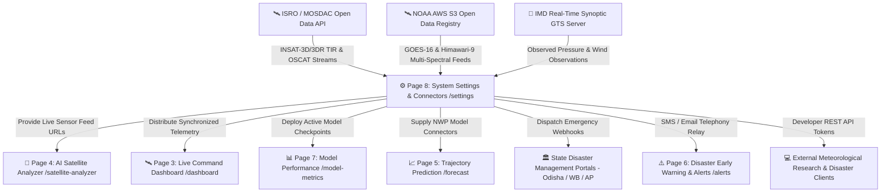

# ⚙️ CYCLO-AI: Page 8 — System Settings & Data Connectors (`/settings`)

**Project Topic:**  
> *"To develop an Artificial Intelligence (AI) / Machine Learning (ML) based system for identification, classification, and prediction of different tropical cyclone patterns using multi-source satellite data."*

**Document Scope:** Complete Architectural, Technical, Operational, Security, Hardware Telemetry, API Hub, and Infrastructure Specification of **Page 8: System Settings & Data Connectors**.

---

## 🗺️ 1. Navigation Flow & System Context

Page 8 is the mission-control administrative and infrastructure backbone of CYCLO-AI. It orchestrates incoming multi-spectral satellite data streams from space agency feeds, manages deep learning inference hardware and active neural network checkpoints, coordinates automated disaster webhooks to state emergency centers, and exposes high-throughput developer REST APIs for national disaster networks.



---

## 📐 2. Visual Layout & Wireframe Architecture

The page adopts a modular mission-control configuration organized into **Top Administrative Status Horizon**, **Category Navigation Pill Bar**, and **Dynamic Glassmorphic Settings Panels**:

```
┌──────────────────────────────────────────────────────────────────────────────────────────────────────────────────┐
│ [CYCLO-AI SETTINGS] [Role: 🛡️ Chief Meteorologist / Admin] [Engine: v2.4-Hybrid-ConvNeXt-ViT] [● Sync: Healthy]   │
├──────────────────────────────────────────────────────────────────────────────────────────────────────────────────┤
│ CATEGORIES: [ 🛰️ Satellite Feeds ]  [ 🧠 AI Engine & Hardware ]  [ 🔔 Emergency Webhooks ]  [ 💻 Developer API Hub ] │
├─────────────────────────────────────────────────────────────────────────────────┬────────────────────────────────┤
│ ┌─────────────────────────────────────────────────────────────────────────────┐ │ 🖥️ HARDWARE TELEMETRY & STATUS │
│ │ 🛰️ SATELLITE DATA FEED CONNECTORS                                            │ │ ┌────────────────────────────┐ │
│ │                                                                             │ │ │ GPU: NVIDIA RTX 4090 / A100│ │
│ │ 🛰️ ISRO MOSDAC Open Data API Connector                                      │ │ │ VRAM: 14.2 / 24 GB (59.1%) │ │
│ │ Endpoint: [ https://api.mosdac.gov.in/v2/insat3d/open                     ] │ │ │ Latency: 24.8 ms / frame   │ │
│ │ API Key:  [ mosdac_live_98f4••••••••••••••••                            👁️] │ │ └────────────────────────────┘ │
│ │ Latency:  18 ms (Green) | Status: 🟢 ACTIVE | Sensors: TIR-1, TIR-2, WV     │ │ 📦 ACTIVE CHECKPOINT DETAILS │
│ │ [ 🔄 Test Ping MOSDAC ]       [ 💾 Save MOSDAC Config ]                      │ │ Model: v2.4-convnext-vit     │
│ │                                                                             │ │ Parameters: 87.4 Million     │
│ │ 🌐 NOAA Open Data AWS S3 Registry                                           │ │ PINN Loss Target: < 0.005    │
│ │ S3 Bucket: [ s3://noaa-goes16/abi-l2-cmip/                                ] │ │ Precision: FP16 TensorRT     │
│ │ Sync Frequency: (●) 15m   ( ) 30m   ( ) 1h   [ 🔘 Anonymous Read ]          │ ├────────────────────────────────┤
│ │ Last Synced: 2 mins ago | Staging Dir: /var/data/staging (18.4 GB / 50 GB)  │ │ 🔔 DISASTER WEBHOOK DISPATCH │
│ └─────────────────────────────────────────────────────────────────────────────┘ │ Odisha SDMA: 🟢 Connected    │
│ ┌─────────────────────────────────────────────────────────────────────────────┐ │ WB Disaster: 🟢 Connected    │
│ │ 💻 DEVELOPER REST API & TOKEN MANAGEMENT                                    │ │ AP Disaster: 🟡 1 Retry      │
│ │ Active Tokens: 3 Created | Rate Limit: 1,200 req/min (Enterprise EOC)       │ │ [ 📡 Send Test Broadcast ]   │
│ │ [ ➕ Generate New Bearer Token ]  [ 📋 Interactive Swagger Documentation ↗ ]  │ ├────────────────────────────────┤
│ │ GET  /api/v1/cyclone/active   ──▶ 200 OK (Live storm state)                 │ │ 💾 SYSTEM CONFIG SNAPSHOT    │
│ │ POST /api/v1/predict/trajectory ──▶ 200 OK (Deep learning trajectory infer) │ │ [ 📥 Export Config JSON ]    │
│ └─────────────────────────────────────────────────────────────────────────────┘ │ [ 📤 Import Configuration ]  │
└─────────────────────────────────────────────────────────────────────────────────┴────────────────────────────────┘
```

---

## 🧩 3. Section-by-Section Feature Specifications

### Section A: Satellite Data Feed Connectors & Sync Orchestration (`#satellite-feeds`)
* **Component ID:** `#satellite-feed-connectors`
* **Typography:** Category Header `Space Grotesk 600`, Endpoints `JetBrains Mono 600`, Descriptions `Plus Jakarta Sans 400`.
* **Sub-Features & Connectors:**
  1. **ISRO / MOSDAC Open Data API Connector:**
     * **Target Agency:** Space Applications Centre (SAC), ISRO.
     * **Endpoint URL Input:** Pre-populated with `https://api.mosdac.gov.in/v2/insat3d/open` (editable with reset button).
     * **API Key Credential Field:** Password-masked input with toggle reveal eye icon (`mosdac_live_••••••••`), stored with AES-256 encryption.
     * **Channel Ingestion Toggles:** Independent switches for `TIR-1 (10.8 µm)`, `TIR-2 (12.0 µm)`, `WV (6.7 µm)`, `VIS (0.65 µm)`, and `Oceansat OSCAT (Ku-Band)`.
     * **Real-time Diagnostic Ping:** Dedicated `Test Connection` button calculating live Round-Trip Time (RTT in $ms$) and HTTP handshake validity.
     * **Connection Health Beacon:** Status pill displaying `🟢 ONLINE (18ms)` | `🟡 HIGH LATENCY (>150ms)` | `🔴 UNREACHABLE`.
  2. **NOAA Open Data AWS S3 Ingestion Pipeline:**
     * **Target Dataset:** NOAA GOES-16/18 Advanced Baseline Imager (ABI) and JMA Himawari-9 AHI open archives.
     * **S3 URI Selector:** Direct bucket target (e.g., `s3://noaa-goes16/abi-l2-cmip/`).
     * **AWS Credentials:** Access Key ID, Secret Access Key, and AWS Region (`us-east-1` default) with an optional `Public Anonymous Read` toggle.
     * **Sync Frequency Radio Group:** Real-time sync interval selector (`15 Minutes (Operational)`, `30 Minutes`, `1 Hour`, or `Manual Trigger`).
  3. **Local Satellite Data Staging & Cache Thresholds:**
     * Displays temporary raw NetCDF-4/HDF5 raster storage usage on disk (`18.4 GB used / 50 GB threshold`).
     * **Auto-Purge Toggle:** Automatically discards processed raw satellite tiles older than 48 hours while preserving committed model validation checkpoints.
     * **"Purge Buffer Cache" Action Button:** One-click manual cleanup of cached frame layers with confirmation modal.

---

### Section B: AI Model Engine & Hardware GPU Runtime Manager (`#model-engine`)
* **Component ID:** `#ai-model-engine`
* **Typography:** Headers `Space Grotesk 600`, Telemetry Gauges `JetBrains Mono 700`, Checkpoint Tags `JetBrains Mono 500`.
* **Sub-Features & Specifications:**
  1. **Active Neural Network Checkpoint Selector:**
     * Interactive card deck displaying trained PyTorch / TensorRT model architectures:
       * **`v2.4-convnext-vit-ensemble` [ACTIVE & RECOMMENDED]:** Dual-branch multi-spectral feature extractor fused with spatial Vision Transformer. Parameter count: $87.4\text{M}$.
       * **`v2.3-swin-transformer-large`:** Hierarchical Shifted-Window Attention network for large-radius curved band classification. Parameter count: $112.1\text{M}$.
       * **`v2.1-resnet50-baseline`:** Standard baseline model for legacy comparisons. Parameter count: $25.6\text{M}$.
       * **`v3.0-experimental-mamba-vision`:** State-space model (SSM) for linear-time temporal sequence modeling.
     * **"Deploy Checkpoint to Production" Button:** Instant zero-downtime hot-swap of the active inference model across `/satellite-analyzer` and `/forecast`.
  2. **Physics-Informed Neural Network (PINN) Weight Tuning:**
     * Interactive weight sliders for the atmospheric loss formulation:
       * Navier-Stokes Conservation Penalty ($\lambda_{\text{NS}}$): Default `0.05`.
       * Coriolis Drift Force Coefficient ($\lambda_{\text{Coriolis}}$): Default `0.02`.
       * Sea Surface Temperature (SST) Thermal Coupling ($\lambda_{\text{SST}}$): Default `0.03`.
     * Reset-to-Default button returning to scientifically validated baseline weights.
  3. **Hardware GPU Telemetry & Compute Precision:**
     * **Live GPU Load Gauge:** Hardware monitor displaying GPU Core Load percentage, temperature ($62^\circ\text{C}$), and fan RPM.
     * **VRAM Allocation Meter:** Visual progress bar (`14.2 GB / 24.0 GB` allocated on NVIDIA RTX 4090 / A100).
     * **Inference Latency Stopwatch:** Real-time benchmark readout ($24.8\text{ ms}$ average latency per $1024 \times 1024$ multi-spectral input tensor).
     * **Precision Mode Selector:**
       * `FP16 (Mixed Precision)`: Default operational mode balancing double throughput with zero loss of classification precision.
       * `FP32 (Single Precision)`: Research validation mode for numerical sensitivity benchmarking.
       * `INT8 (TensorRT Quantization)`: Edge computing mode for disaster transport vehicles with limited onboard VRAM.

---

### Section C: Disaster Webhook Integrations & Telephony Relays (`#webhooks`)
* **Component ID:** `#notification-webhooks`
* **Typography:** Endpoints `JetBrains Mono 600`, Payload Previews `JetBrains Mono 400`, Agency Labels `Rajdhani 600`.
* **Sub-Features & Specifications:**
  1. **State Disaster Management Authority (SDMA) Webhook Registry:**
     * Pre-configured webhooks for coastal disaster operations:
       * **Odisha SDMA (OSDMA):** `https://osdma.odisha.gov.in/api/v1/cyclone-alerts`
       * **West Bengal Disaster Management:** `https://wbdmd.gov.in/hooks/early-warning`
       * **Andhra Pradesh SDMA (APSDMA):** `https://apsdma.ap.gov.in/telemetry/inbound`
       * **Tamil Nadu Disaster Agency (TNDMA):** `https://tndma.tn.gov.in/cap-listener`
     * **Event Trigger Multi-Select:** Choose which operational triggers dispatch payloads:
       * `[x] Cyclone Genesis Detection (T >= 2.5)`
       * `[x] Rapid Intensification Alert (dV/dt >= 30 kts / 24h)`
       * `[x] IMD Stage 3 Warning (Landfall T-24h)`
       * `[x] Coastal Inundation Surpass (> 2.0m Surge)`
     * **Payload Standard Selector:** Dropdown between `CAP-XML v1.2 (WMO Standard)` and `CYCLO-AI JSON v1.0`.
     * **HMAC Secret Signature Field:** SHA-256 verification secret passed via the `X-Cyclo-Signature` HTTP header to prevent spoofing.
     * **"Send Test Ping Payload" Button:** Sends a mock Cyclone Amphan test vector with an inline response inspector showing status codes (`HTTP 200 OK`) and latency.
  2. **Emergency Telephony SMS & Email Relay Gateways:**
     * **National CDAC CAP SMS Gateway:** Integrates with India's Common Alerting Protocol server for cell-broadcast emergency notifications.
     * **SMTP Notification Relay:** Host (`smtp.gov.in`), Port `587`, TLS encryption, sender identity (`alerts@cyclo-ai.imd.gov.in`), and administrative recipient email tags.

---

### Section D: Developer API Hub & Token Management (`#api-hub`)
* **Component ID:** `#developer-api-hub`
* **Typography:** Endpoints `JetBrains Mono 600`, JSON Schema `JetBrains Mono 400`, Buttons `Rajdhani 700`.
* **Sub-Features & Specifications:**
  1. **REST API Key & Bearer Token Management:**
     * Table of active authorization tokens with columns: Token Name, Prefix (`cyc_live_••••`), Scope, Rate Limit, Created Date, Last Used, and Revoke action.
     * **"Generate New API Key" Modal:** Allows creating scoped tokens:
       * `read:active_storms`: Query live LLCC positions, maximum sustained winds, and intensity grades.
       * `predict:trajectory`: Submit custom multi-spectral arrays to invoke forward trajectory predictions.
       * `admin:configuration`: Read and update system settings remotely.
     * **Rate Limiting Policies:** Visual badge showing current quota ($1,200\text{ req/min}$ for institutional research partners).
  2. **Interactive OpenAPI / Swagger Documentation Preview:**
     * Tabbed interactive request/response console testing live endpoints directly in browser:
       * **`GET /api/v1/cyclone/active`**: Returns active Indian Ocean storm profiles, coordinates, Dvorak T-numbers, and warning stages.
       * **`POST /api/v1/predict/trajectory`**: Ingests timestamped lat/lon coordinates and returns 120-hour forecast points with cone polygons.
       * **`GET /api/v1/telemetry/hardware`**: Reports GPU temperature, VRAM usage, and active model checkpoint metadata.
  3. **Multi-Language SDK Code Snippets:**
     * Copyable code templates with syntax highlighting in **cURL**, **Python (requests)**, **JavaScript / TypeScript (fetch)**, and **Go**.

---

### Section E: System Telemetry, Audit Logs & Access Control (`#security`)
* **Component ID:** `#security-audit-panel`
* **Typography:** Audit Log Timestamps `JetBrains Mono 500`, Role Badges `Rajdhani 600`.
* **Sub-Features & Specifications:**
  1. **Role-Based Access Control (RBAC) Overview:**
     * Active User: `Dr. S. Mukherjee (Senior Meteorologist / Admin)`.
     * Agency Badge: `IMD / Cyclone Warning Division (New Delhi)`.
     * Permission Clearance: `Level 4: Full Administrative & Webhook Authority`.
  2. **Operational Audit Trail:**
     * Real-time chronological audit table recording system modifications:
       * `2026-10-15 08:30:12 UTC`: *Model checkpoint swapped from v2.3 to v2.4-convnext-vit.*
       * `2026-10-15 07:15:40 UTC`: *MOSDAC API Key rotated successfully.*
       * `2026-10-15 06:00:00 UTC`: *Dispatched automated Stage 3 warning payload to Odisha SDMA.*
  3. **Configuration Backup & Migration:**
     * **"Export System Configuration" Button:** Downloads current connectors, webhook URLs, and tuning parameters as `cyclo_ai_settings.json`.
     * **"Import Configuration" Button:** Validates and ingests settings archives for rapid replication across backup command centers.

---

## 🎛️ 4. Exhaustive Matrix of Buttons & Interactive Controls on Page 8

| # | UI Element / Control Name | Section / Anchor | Element Type | Normal / Hover Styling | On-Click / Interaction Action | Target Destination / Output |
| :-: | :--- | :--- | :--- | :--- | :--- | :--- |
| **1** | **Category Pill Navigation** | Top Horizon Bar | Segmented Nav Bar | Translucent Cyan Pill (`rgba(0,242,254,0.1)`) | Smooth-scrolls to anchor section | Jumps to `#satellite-feeds`, `#model-engine`, etc. |
| **2** | **"Save All Settings" CTA** | Top Horizon Bar (Right) | Primary Action Button | Electric Cyan fill (`#00F2FE`) with black text | Commits modified configs to local store / DB | Toast notification: *"Configuration saved"* |
| **3** | **"Revert Changes" Button** | Top Horizon Bar (Right) | Secondary Outline Button| Translucent Slate with cyan border | Reverts unsaved field modifications | Resets inputs to initial snapshot |
| **4** | **MOSDAC API Key Reveal Toggle**| Satellite Feeds | Icon Button (Eye) | Slate text, glowing cyan hover | Toggles password masking on key string | Reveals/hides `mosdac_live_••••••••` |
| **5** | **"Test Ping MOSDAC" Button** | Satellite Feeds | Outlined Tool Button | Border `rgba(0,242,254,0.5)`, Cyan glow | Dispatches lightweight HTTP HEAD handshake | Displays ping latency badge (`18 ms`) |
| **6** | **TIR-1 Channel Switch** | Satellite Feeds | Glass Toggle Switch | Cyan track when active, slate when disabled | Enables/disables TIR-1 ingestion stream | Updates active satellite ingest pipeline |
| **7** | **TIR-2 Channel Switch** | Satellite Feeds | Glass Toggle Switch | Cyan track when active, slate when disabled | Enables/disables TIR-2 ingestion stream | Updates active satellite ingest pipeline |
| **8** | **Water Vapor (WV) Switch** | Satellite Feeds | Glass Toggle Switch | Cyan track when active, slate when disabled | Enables/disables WV channel ingestion | Updates active satellite ingest pipeline |
| **9** | **NOAA S3 Anonymous Toggle** | Satellite Feeds | Checkbox Toggle | Cyan fill when checked | Disables AWS credential requirement | Swaps S3 client to unauthenticated mode |
| **10**| **S3 Sync Frequency Radios** | Satellite Feeds | Radio Button Group | Active: Cyan ring with center dot | Configures automated fetch interval | Sets interval to 15m / 30m / 1h |
| **11**| **"Purge Buffer Cache" Button**| Satellite Feeds | Warning Button | Border `rgba(255,94,54,0.6)`, Coral hover | Clears cached raw NetCDF raster tiles | Confirmation modal -> frees disk space |
| **12**| **Model Checkpoint Cards** | AI Model Engine | Selectable Radio Cards | Border `rgba(0,242,254,0.3)`, Cyan ring on select| Selects candidate neural network weight | Updates candidate model profile |
| **13**| **"Deploy Checkpoint" CTA** | AI Model Engine | Primary Action Button | Emerald Green gradient (`#00E676`) | Hot-swaps the active inference engine | Toast notification: *"Checkpoint deployed"* |
| **14**| **Navier-Stokes Weight Slider** | AI Model Engine | Elastic Range Slider | Cyan thumb with glowing track | Adjusts PINN physics penalty $\lambda_{\text{NS}}$ | Updates runtime loss balance |
| **15**| **Precision Mode Selector** | AI Model Engine | Segmented Button Group | Active: Cyan background with dark text | Switches compute mode (FP16/FP32/INT8) | Adjusts TensorRT engine precision |
| **16**| **"Benchmark Latency" Button** | AI Model Engine | Tool Button | Slate glass with speed icon | Runs 50 dummy inference passes | Updates latency gauge ($ms$) |
| **17**| **SDMA Endpoint Checkboxes** | Disaster Webhooks | Checkbox Group | Cyan checkbox when checked | Enables/disables alerts to specific states | Filters webhook dispatch registry |
| **18**| **"Send Test Ping Payload" CTA**| Disaster Webhooks | Outlined Action Button| Border `rgba(0,242,254,0.5)`, Cyan hover | Posts simulated Cyclone Amphan vector | Response preview modal (`HTTP 200 OK`) |
| **19**| **HMAC Secret Key Regenerate** | Disaster Webhooks | Icon Tool Button | Slate glass with refresh icon | Generates cryptographically secure 256-bit key| Updates `X-Cyclo-Signature` secret |
| **20**| **"Send SMS Test" Button** | Disaster Webhooks | Secondary Action Button| Translucent Slate with cyan hover | Dispatches test warning SMS to admin phone | Carrier simulation preview modal |
| **21**| **"Generate New API Key" CTA**| Developer API Hub | Primary Action Button | Glowing Cyan button with plus icon | Opens API key provisioning modal | Modal (Scopes, Quotas, Token copy) |
| **22**| **Token Revoke Button (`🗑️`)** | Developer API Hub | Danger Icon Button | Red/Coral text hover (`#FF5E36`) | Permanently invalidates chosen token | Removes key from active database |
| **23**| **OpenAPI Endpoint Tab Switcher**| Developer API Hub | Tab Bar | Active: Cyan underline, White text | Switches between `/cyclone/active` & `/predict`| Displays chosen endpoint schema |
| **24**| **"Copy Code Snippet" Button**| Developer API Hub | Icon Button (Copy) | Slate glass with copy icon | Copies curl/python/js code to clipboard | Clipboard copy + "Copied!" tooltip |
| **25**| **"Export Config JSON" CTA** | System Security | Secondary Action Button| Outlined Slate with download icon | Packages all settings into JSON archive | Triggers file download (`cyclo_ai_config.json`)|
| **26**| **"Import Config JSON" Button**| System Security | Outlined Action Button| Outlined Slate with upload icon | Opens file picker for config restoration | Triggers schema validation + import |

---

## 🎨 5. Applied Design System & Visual Tokens

Page 8 strictly complies with the CYCLO-AI **Oceanic Cyber Abyss** design system defined in `COLOR_THEME.md` and `TEXT_TYPES.md`:

### 1. The Golden Ratio 60-30-10 Palette
* **60% Dominant Canvas Base (`--color-canvas-primary`):** `#050B14` (Deep Abyss Navy void minimizing eye strain during extended administrative configurations).
* **30% Structural Surfaces & Cards (`--color-canvas-surface`):** `#0F1B2F` and `#0E3D59` with `backdrop-filter: blur(20px)`, subtle noise texture, and `1.5px solid rgba(0, 242, 254, 0.45)`.
* **10% Brand Accents & Operational Signals:**
  * **Electric Cyclone Cyan (`--color-brand`):** `#00F2FE` (Active toggle switches, API endpoints, latency readouts, and primary save buttons).
  * **Verified / Operational Green (`--color-success`):** `#00E676` (Healthy 18ms latency, active webhook connectivity, and deployed model checkpoint tags).
  * **Hazard Warning / Alert Coral (`--color-critical`):** `#FF5E36` (Buffer cache purge warning, revoked API keys, and offline feed alerts).
  * **Telemetry Yellow / Amber:** `#FFB300` (Degraded satellite feed latency $>150\text{ ms}$ and rate limit threshold warnings).

### 2. Typographic Mapping (`TEXT_TYPES.md` Section 3.8)
* **Settings Category Headers:** `Space Grotesk 600` (`letter-spacing: -0.02em`).
* **Section Titles & Brand Logos:** `Orbitron 800` (`letter-spacing: 0.06em; text-transform: uppercase`).
* **Interactive Button Labels & Pill Tags:** `Rajdhani 700` (`letter-spacing: 0.05em; text-transform: uppercase`).
* **API Endpoints, JSON Code & Hex Values:** `JetBrains Mono 600 / 400` (`font-feature-settings: 'tnum' on`).
* **Telemetry Numbers & Latency Readouts:** `JetBrains Mono 700` (`font-feature-settings: 'tnum' on, 'zero' on`).
* **Setting Descriptions & Form Help Notes:** `Plus Jakarta Sans 400 / 500` (`line-height: 1.6`).

---

## 📐 6. Technical Architecture, Security & Mathematical Specifications

### 1. Webhook HMAC-SHA256 Payload Signing
To guarantee authentic disaster bulletins and prevent third-party spoofing of early warning payloads, every outbound webhook request carries a cryptographic signature in the header:

$$\text{Signature} = \text{HMAC-SHA256}(\text{Payload JSON}, \mathcal{K}_{\text{secret}})$$

Header passed:
```http
X-Cyclo-Signature: sha256=4f8b9e6a8d7c1e2f3a4b5c6d7e8f9a0b1c2d3e4f5a6b7c8d9e0f1a2b3c4d5e6f
X-Cyclo-Timestamp: 1760520600
```

### 2. Satellite Feed Polling with Truncated Exponential Backoff & Jitter
When an orbital feed (e.g., MOSDAC or NOAA S3) experiences transient network degradation, the ingestion orchestrator executes exponential backoff to avoid hammering remote space agency servers:

$$T_{\text{wait}}(n) = \min\left(T_{\text{max}}, T_{\text{base}} \cdot 2^n\right) \pm \mathcal{U}(0, \text{jitter})$$

* $T_{\text{base}} = 2\text{ seconds}$
* $T_{\text{max}} = 120\text{ seconds}$
* $n = \text{retry attempt index } (1 \le n \le 5)$
* $\text{jitter} = 0.5 \cdot T_{\text{wait}}$ (prevents synchronized thundering herd spikes)

### 3. Real-Time Hardware Latency Benchmarking Formulation
The runtime inference latency displayed on the hardware card is computed across an exponential moving average (EMA) of the last $N=100$ forward inference passes:

$$\bar{\tau}_k = \alpha \cdot \tau_k + (1 - \alpha) \cdot \bar{\tau}_{k-1}$$

where smoothing factor $\alpha = 0.15$ and $\tau_k$ is the GPU kernel execution time measured via `cudaEventElapsedTime()`.

### 4. Interactive OpenAPI 3.1 Endpoint Schemas

#### Endpoint 1: Active Tropical Cyclone Query
* **Method & Route:** `GET /api/v1/cyclone/active`
* **Response Body (`200 OK`):**
```json
{
  "system": "CYCLO-AI Operational Core v2.4",
  "timestamp": "2026-10-15T09:30:00Z",
  "active_cyclones_count": 1,
  "data": [
    {
      "storm_id": "BOB-02-2020",
      "name": "Super Cyclone AMPHAN",
      "basin": "North Indian Ocean (Bay of Bengal)",
      "current_llcc": {
        "latitude": 19.8,
        "longitude": 86.9,
        "coordinates_string": "19.8°N, 86.9°E"
      },
      "intensity": {
        "max_sustained_wind_kts": 130,
        "max_sustained_wind_kmh": 240,
        "central_pressure_hpa": 926,
        "dvorak_t_number": "T-6.5",
        "category": "Super Cyclonic Storm (SuCS)"
      },
      "warning_stage": "Stage 3 (Cyclone Warning - Red Alert)",
      "projected_landfall": {
        "location": "Digha, West Bengal Coast",
        "eta": "2020-05-20T11:30:00Z",
        "surge_height_m": 3.8
      }
    }
  ]
}
```

#### Endpoint 2: Deep Learning Forward Trajectory Inference
* **Method & Route:** `POST /api/v1/predict/trajectory`
* **Request Payload (`application/json`):**
```json
{
  "storm_id": "BOB-02-2020",
  "current_time": "2020-05-18T12:00:00Z",
  "forecast_horizon_hours": 72,
  "model_checkpoint": "v2.4-convnext-vit-ensemble",
  "include_uncertainty_cone": true,
  "current_state": {
    "lat": 19.8,
    "lon": 86.9,
    "v_max_kts": 130,
    "p_c_hpa": 926
  }
}
```

---

*Maintained as the official Page 8 Technical Specification for CYCLO-AI (SIH 2026).*
